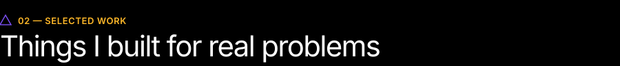
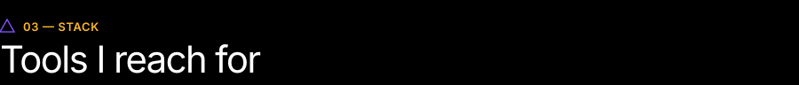

 

Software engineer at **Discovery** and UCT Computer Science & Information Systems graduate, working where **AI, data engineering and full-stack systems** meet. I like systems that do real work: pipelines that clean data at scale, agents that reason over messy records, and AI that hands the final call to a human.

   

- **Enterprise data systems** at Discovery, in Systems of Engagement: Data Management
- **AI-powered pipelines** — LLM agents wired into real databases, with confidence scores and audit trails
- **Healthcare technology** — scalable platforms, and multimodal AI that pairs vision models with general-purpose LLMs
- **A cross-border bus booking platform** for South Africa and Zimbabwe

  

**Med X** · *Top 28 global, Red Bull Basement 2024*
An AI-enabled healthcare platform for underserved communities: digital medical records, patient and doctor dashboards, appointments, AI-assisted triage, document analysis and telemedicine. The triage layer surfaces candidate conditions with urgency flags; doctors keep final authority.
`React Native` · `AI/ML` · `Firebase` · `WebRTC`

**Name-fixer agent**
An AI agent that finds and corrects misspelled name fields in SQL / PostgreSQL databases. Fuzzy matching (`rapidfuzz`) pre-filters candidates, Gemini proposes corrections as structured JSON with confidence scores, and a two-tier gate auto-applies only high-confidence fixes — everything else goes to a human-review CLI. Every change is logged.
`Python` · `SQLAlchemy` · `Gemini` · `PostgreSQL`

**NEXA** · *UCT capstone*
Offline-first messaging for places where connectivity comes and goes. Co-architected in a team of three: peer-to-peer networking, encrypted group messaging, routing and resumable file transfers.
`.NET MAUI` · `C#` · `P2P networking` · `Encryption`

**LowN**
Peer-to-peer lending on Interledger Open Payments, widening access to credit without traditional intermediaries. Built at a fintech innovation hackathon.
`Next.js` · `TypeScript` · `Interledger`

[More projects, with interactive 3D views →](https://lalelanieddienene.netlify.app/#projects)

  

  
  
  
  
  
  
  
  
  
  
  
  
  
  
  
  
  

  

  
  

  

Happy to talk about software engineering, AI, data, or anything I've built.

[Portfolio](https://lalelanieddienene.netlify.app/) &nbsp;·&nbsp; [Email](mailto:lalelaninene@gmail.com) &nbsp;·&nbsp; [LinkedIn](https://www.linkedin.com/in/lalelani-nene-8563291a3/) &nbsp;·&nbsp; [X / Twitter](https://twitter.com/lalelani_eddie) &nbsp;·&nbsp; [YouTube](https://www.youtube.com/@Lalelani_Eddie_Nene/videos)

 

